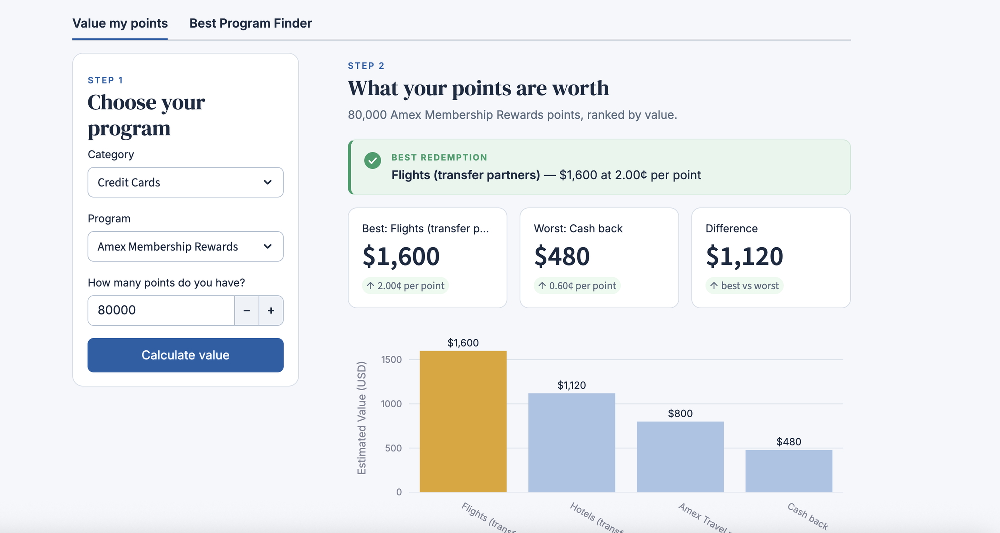
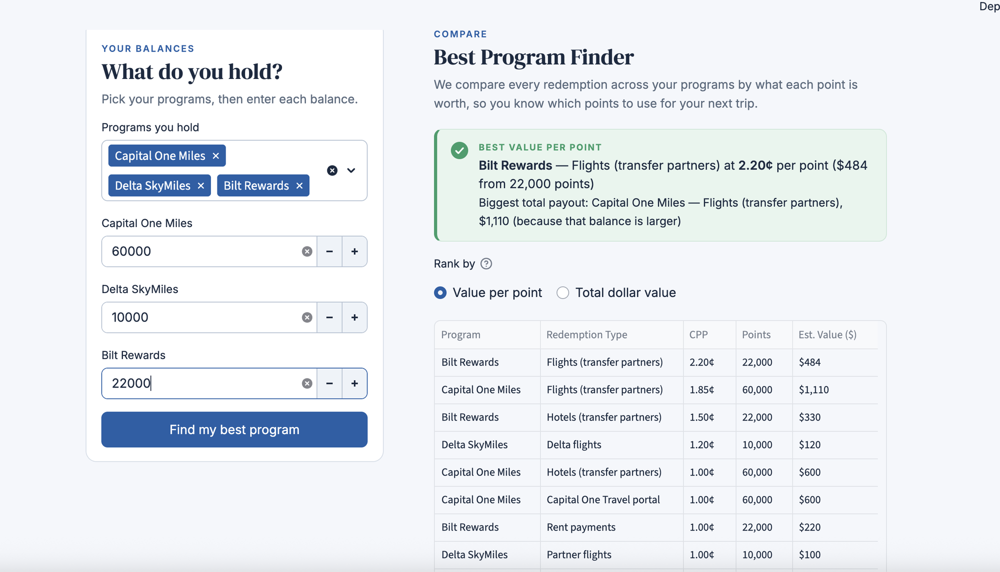

# PointsWorth — Redeem Right

**See what your loyalty points are actually worth.**

PointsWorth converts a credit card, airline or hotel points balance into dollars using **cents per point (CPP)**, so you can compare programs that use completely different currencies and pick the redemption that gives you the most value.

**[Try the live app →](https://points-comparison-1-lchs7pxez8ghfgvhkbkr7k.streamlit.app/)**



## Why I built it

50,000 Chase points and 50,000 Delta miles look the same on a statement but aren't worth the same. The same balance can also be worth very different amounts depending on how you spend it: transfer partners, a travel portal, or cash back. I wanted a quick way to put every option on the same scale, the same way you'd normalize figures before comparing companies.

## Features

- **Value my points:** pick a program, enter your balance, and see every redemption option ranked by dollar value with a chart, best and worst options, and the gap between them.
- **Best Program Finder:** select every program you hold, enter your balances, and get one ranking across all of them, by value per point (which points to spend first) or by total dollar value.
- **13 programs** across credit cards (Chase, Amex, Capital One, Citi, Bilt), airlines (Delta, United, American, Southwest, Alaska) and hotels (Hyatt, Marriott, Hilton).
- **Card-tier ranges:** where value depends on which card you hold (e.g. the Chase Travel portal is 1.25¢ with Sapphire Preferred and 1.50¢ with Sapphire Reserve), the app shows a range instead of a single number.



## How the math works

```
CPP = (dollar value of the redemption ÷ points used) × 100
Estimated value ($) = points × CPP ÷ 100
```

Example: 50,000 points that book a $750 flight = **1.5¢ per point**. The same 50,000 points as $500 cash back = only **1.0¢**.

## Data

All CPP values live in [`data/valuations.csv`](data/valuations.csv), separate from the code:

- **Main redemption for each program** (rows marked `TPG`): The Points Guy's [monthly valuations](https://thepointsguy.com/guide/monthly-valuations/), currently **November 2026**.
- **Other options** (portals, cash back, upgrades, rows marked `Estimate`): typical published rates.

The app shows the source and last-updated date under the header. The dot turns amber if the data is more than 45 days old.

### Updating the data (monthly)

1. Check TPG's monthly valuations (usually published in the first week of the month).
2. Update the `TPG` rows in `data/valuations.csv`.
3. Update `valuation_month` and `last_updated` in [`data/meta.json`](data/meta.json).
4. Commit and push. Streamlit Cloud redeploys automatically.

## Built with

| Tool | What it does here |
|---|---|
| [Python](https://www.python.org/) | Core logic |
| [Streamlit](https://streamlit.io/) | Web interface, inputs and layout |
| [pandas](https://pandas.pydata.org/) | Organizes redemption data into tables |
| [Plotly](https://plotly.com/python/) | Interactive bar chart |

Deployed for free on Streamlit Community Cloud. Designed and built with the help of [Claude](https://claude.com/claude-code).

## Run it locally

```bash
git clone https://github.com/Khuslen5000/Points-Comparison-1.git
cd Points-Comparison-1
pip install -r requirements.txt
streamlit run app.py
```

Then open http://localhost:8501.

## About

Built by Huslen · [GitHub](https://github.com/Khuslen5000)
